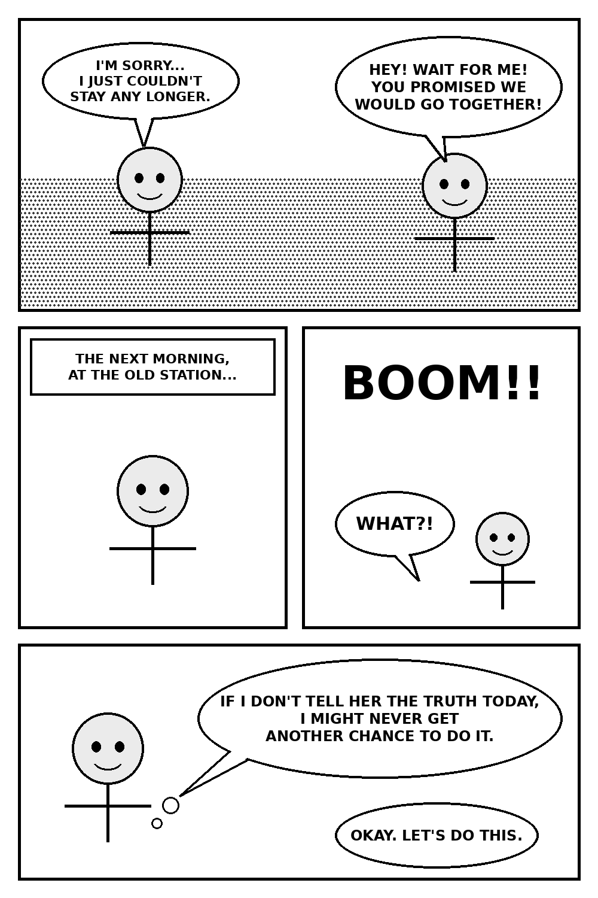
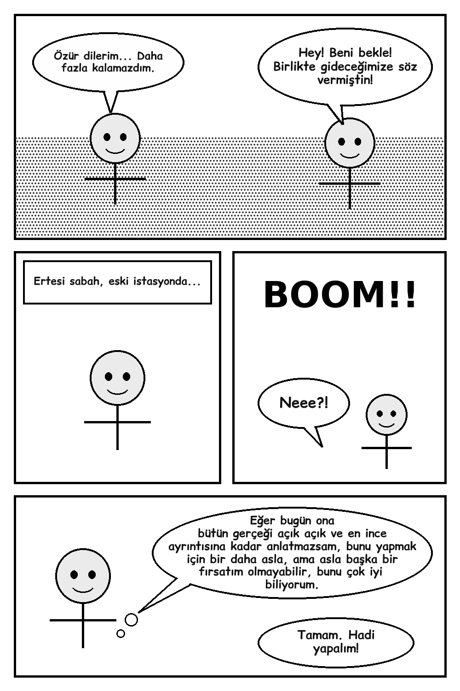
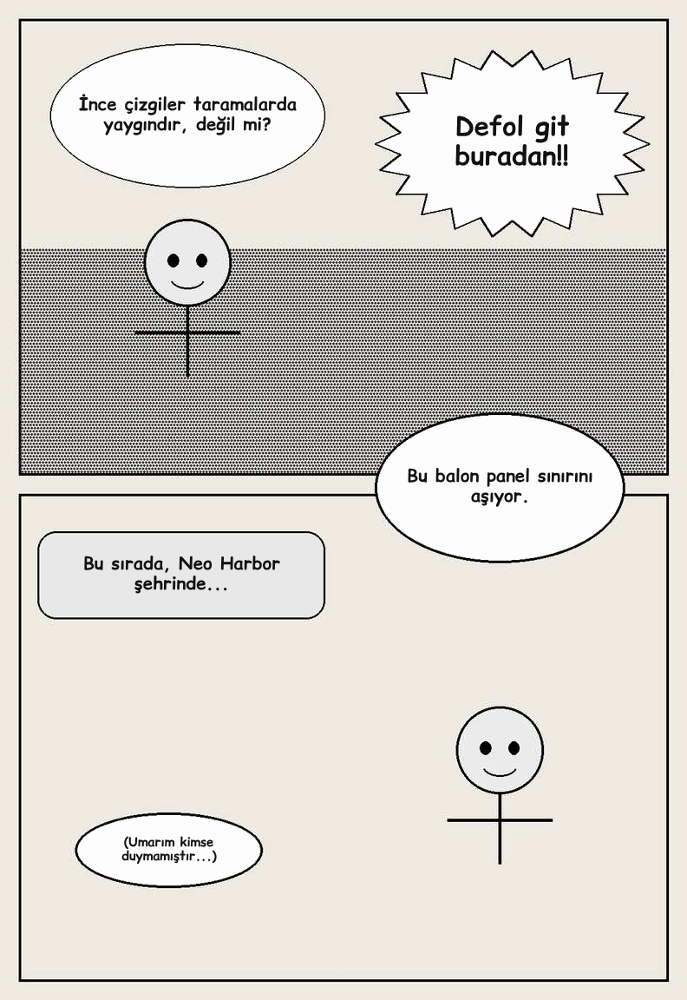

# Manga Çeviri TR — Tarayıcı Eklentisi

İngilizce manga sayfalarındaki **konuşma balonlarını bulur**, **Türkçeye çevirir**
ve çeviriyi **balona sığacak şekilde** orijinal yazının üstüne yerleştirir.

**İki çeviri motoru var:**

| | **Ücretsiz (varsayılan)** | **Claude API (isteğe bağlı)** |
|---|---|---|
| Ücret / hesap | Yok — API anahtarı gerekmez | Ücretli API anahtarı |
| Nerede çalışır | Tamamen bilgisayarda (yazı okuma: Tesseract, çeviri: Chrome'un yerleşik çevirmeni) | Anthropic sunucusu |
| Hız | Sayfa başı ≈ 1 saniye | Hızlı modda sayfa başı ≈ 5-12 sn, 4 sayfa aynı anda (tahmin) |
| Çeviri kalitesi | Makine çevirisi: anlaşılır ama daha düz | En doğal: ton, sen/siz hitabı, ünlemler korunur, sığmayanı anlamı bozmadan kısaltır |
| Tarayıcı | **Google Chrome** (güncel, bilgisayar) | Chrome, Edge, Brave, Opera |

| Önce | Sonra |
|---|---|
|  |  |

> Görseller bu proje için çizilmiş özgün test sayfasıdır (`test/ornek-sayfa-uret.py`).

Zor koşullar testi (düşük kaliteli JPEG, kirli kâğıt rengi, ince çizgi, dikenli bağırma balonu,
gri kutu, panel sınırını aşan balon):



---

## 1. Kurulum (5 dakika)

> **Ücretsiz motor için Google Chrome kullanın.** Chrome'un yerleşik çevirmeni Edge, Opera ve Brave'de
> bulunmayabilir. Chrome'u güncellemek için: Chrome menüsü → Yardım → Google Chrome hakkında.

1. Bu depoyu bilgisayarına indir: GitHub'da **Code → Download ZIP**, sonra ZIP'i bir klasöre çıkar.
2. Tarayıcıda eklentiler sayfasını aç:
   - Chrome / Brave: adres çubuğuna `chrome://extensions`
   - Edge: `edge://extensions`
3. Sağ üstteki (Edge'de sol alttaki) **Geliştirici modu**'nu aç.
4. **Paketlenmemiş öğe yükle** (Load unpacked) düğmesine bas ve indirdiğin klasörün içindeki
   **`eklenti`** klasörünü seç.
5. Eklenti listede **Manga Çeviri TR** olarak görünür. Araç çubuğundaki yapboz simgesinden
   eklentiyi **sabitle** ki pembe "TR" simgesi hep görünsün.

### İlk ayar (bir kez)

1. Eklenti simgesine tıkla → sağ üstteki **⚙** → **Ücretsiz** seçili olsun.
2. **Türkçe paketi hazırla ve dene** düğmesine bas. Chrome Türkçe çeviri paketini bir kez indirir ve örnek bir
   cümle çevirir ("✓ Hazır" yazısını gör). Sonra **Kaydet**.
3. Manga sitesinde ilk kez çevirirken panelde **"Türkçe çeviri paketini hazırla"** düğmesi çıkarsa bir kez
   ona bas (Chrome her site için ilk seferde bir tıklama ister).

### İsteğe bağlı: Claude API (en doğal çeviri, ücretli)

Daha doğal çeviri istersen ayarlardan **Claude API** motorunu seç ve bir API anahtarı gir:

1. [platform.claude.com](https://platform.claude.com/) adresinde hesap aç.
2. **Billing** bölümünden küçük bir bakiye yükle (5 $ yüzlerce sayfaya yeter, aşağıdaki maliyet tablosuna bak).
3. **API Keys** → **Create Key**, anahtarı kopyala.
4. Eklenti simgesine tıkla → sağ üstteki **⚙** → anahtarı yapıştır → **Anahtarı test et** → **Kaydet**.

Anahtar yalnızca senin tarayıcında (`chrome.storage.local`) saklanır; koda gömülü değildir, manga sitesine
asla gönderilmez, sadece `api.anthropic.com`'a gider.

## 2. Kullanım

- Manga sayfasını aç → eklenti simgesine tıkla → **Bu sayfayı çevir**.
  Ya da kısayol: **Alt + Shift + T**. Ya da sayfada sağ tık → **Bu sayfadaki mangayı çevir**.
- Sağ altta küçük bir panel ilerlemeyi gösterir. Çeviri bitince görseller yerinde değişir.
- **Orijinale dönmek:** paneldeki **Orijinal** düğmesi (tümü) veya görsele **Alt + tık** (tek görsel)
  veya görselde sağ tık → **Çeviri ↔ Orijinal**. Tespit yanlışsa böyle anında orijinale dönülür.
- **Uzun bölümler / webtoon:** popup'taki **Yeni yüklenen sayfaları otomatik çevir** kutusunu işaretle;
  aşağı kaydırdıkça yüklenen sayfalar da çevrilir.
- Tek bir görseli çevirmek: görselde sağ tık → **Bu görseli Türkçeye çevir**.
- Aynı sayfayı tekrar açarsan çeviri **önbellekten** anında gelir (Claude motorunda tekrar ücret ödenmez).

## 3. Nasıl çalışıyor? (aşama aşama)

Proje istenen 5 aşamaya göre düzenlendi. Her aşamanın kodu ayrı dosyada ve Türkçe yorumlu.

```
eklenti/
├── manifest.json        Eklentinin kimlik kartı: izinler, simgeler, kısayol
├── background.js        Arka plan: görsel indirme (CORS), motor seçimi, Claude API, önbellek, sağ tık menüsü
├── content.js           Sayfada çalışan kısım: görselleri bulma, işleme, değiştirme, panel
├── offscreen.html/js    Ücretsiz motor: gizli sayfada OCR (Tesseract) + Chrome çevirmeni
├── vendor/tesseract/    Gömülü OCR motoru ve İngilizce verisi (Apache 2.0, internet gerekmez)
├── lib/detector.js      Balon tespiti (tarayıcıda, kütüphanesiz görüntü işleme)
├── lib/layout.js        Türkçeyi balona sığdırma, İngilizceyi kapatma, yazma
├── popup.html/js        Simgeye tıklayınca açılan pencere
├── options.html/js      Ayarlar sayfası
├── ui.css               Popup ve ayarlar stili
├── fonts/               Türkçe karakter destekli çizgi roman fontu (Comic Relief, OFL lisansı)
└── icons/
test/
├── ornek-sayfa-uret.py  Özgün test manga sayfaları üretir
├── tespit-testi.js      Balon tespitini görselleştirir
├── ucretsiz-motor-test.js  Ücretsiz motoru (gerçek OCR) Chromium'da test eder
└── uctan-uca-test.js    Claude motoruyla baştan sona test (API taklit edilir)
```

### Aşama 1 — Klasör yapısı ve sayfadaki manga görsellerini listeleme
`content.js → scanImages()` sayfadaki tüm `` etiketlerini tarar; doğal boyutu en az 300×300 olan ve
ekranda en az 150 piksel görünenleri "manga sayfası" sayar (logolar, avatarlar, reklamlar elenir).
**Test:** Manga sayfasında eklenti simgesine tıkla. "Görseller (N)" listesinde sayfaları görmelisin.
Henüz yüklenmemiş (tembel yüklenen) görsel varsa sayısı yanında yazar.

### Aşama 2 — Balonları ve yazıları bulma (`lib/detector.js`)
Bilgisayarlı görü kısmı tamamen tarayıcıda, ek kütüphane olmadan yapılır:
1. Görüntü gri tonlamaya çevrilir, açık renkli (beyaz) pikseller işaretlenir.
2. Birbirine değen beyaz pikseller gruplanır (bağlı bileşen analizi). Kapalı bir balonun içi tek bir grup olur.
3. Grubun içinde kalan koyu "delikler" harflerdir. İçinde harf benzeri küçük delikler olan, dolu ve makul
   boyutlu gruplar **aday balon** olur. İçi açık renkli büyük delikler (yüz, başka balon) içeren gruplar
   panel/arka plan sayılıp elenir; her yere yayılmış nokta deseni (ekran tonu) elenir.
4. Her balon için sınır kutusu, gerçek şekil maskesi, her satırdaki sol/sağ sınır, arka plan rengi ve
   orijinal harf yüksekliği çıkarılır.
5. **Webtoon gibi çok uzun görseller** üst üste binen dilimlere bölünür; her dilim tam çözünürlükte
   taranır ve ayrı istekle çevrilir. Dilim sınırına denk gelen balon komşu dilimde bütün olarak işlenir,
   hiçbir balon iki kez yazılmaz.

**Yazı okuma (OCR):**
- *Ücretsiz motor:* Balonun yalnızca yazı bölgesi kırpılır, balon çizgisi beyaza boyanır, harfler büyütülür ve
  eklentiye gömülü **Tesseract** ile okunur. Okunan metin gerçek kelimelere benzemiyorsa (yüz, çizim parçası)
  o aday **atlanır**, üstüne yazı yazılmaz. Tek başına "I" harfinin "1"/"|" okunması gibi bilinen hatalar düzeltilir.
- *Claude motoru:* Claude her balonun kırpıntısını görüp kendisi okur ve "konuşma değil" dediği alanlara dokunulmaz.

**Test (geliştirici):** `node test/tespit-testi.js test/ornek/sayfa1.png` → bulunan balonları kırmızı kutuyla çizer.

### Aşama 3 — Çeviri
**Ücretsiz motor (`offscreen.js`):** Chrome'un yerleşik çevirmeni (Translator API) bilgisayarda çevirir.
Manga yazıları BÜYÜK HARF olduğu için çeviriden önce normal cümle düzenine çevrilir ("I'M SORRY" → "I'm sorry").
Motor gizli bir sayfada açık tutulur, böylece her sayfada yeniden yüklenmez. Bu sayfada çevirmen kullanılamazsa
çeviri manga sitesinin içinde yapılır.

**Claude motoru (`background.js → translateBubbles()`):**
- Sayfanın tamamı (bağlam: kim kime konuşuyor) + numaralı balon kırpıntıları tek istekte gönderilir.
- Her balon için **"en fazla N karakter"** sınırı modele söylenir. N, balonun gerçek şekline ve okunabilir
  en küçük yazı boyutuna göre hesaplanır (`layout.js → estimateCapacity()`).
- İstem (prompt) şunları ister: birebir değil doğal çeviri, karakterin tonu ve sen/siz hitabı, ünlem ve
  kekelemelerin korunması, isim ve -san/-kun/senpai gibi eklerin değiştirilmemesi, sığmıyorsa anlamı koruyarak kısaltma.
- Yanıt JSON şemasıyla (structured outputs) zorunlu biçimde gelir, bozuk yanıt riski yoktur.
- **Bölüm boyunca tutarlılık:** önceki sayfalarda yapılan son 20 çeviri bağlam olarak gönderilir; böylece
  bir karakterin adı, lakabı ve "sen/siz" hitabı sayfadan sayfaya değişmez.

### Aşama 4 — Sığdırma ve yazma (`lib/layout.js`)
1. İngilizce yazı, balonun kendi arka plan rengiyle balonun şekli boyunca kapatılır (kenar çizgisi korunur).
2. Türkçe metin büyük yazı boyutundan başlanarak 1, 2, 3… satır denenir; oval balonlarda her satır o
   yükseklikteki balon genişliğine göre kırılır, ortalanır.
3. **Sığmazsa:** önce yazı küçültülür (ayarlardaki en küçük boyuta kadar). Claude motorunda hâlâ sığmıyorsa o balonlar
   daha sıkı karakter sınırıyla **modele kısalttırılır** (ucuz, sadece metin isteği). Ücretsiz motorda ve son çare
   olarak yazı biraz daha küçültülür, gerekirse kelime bölünür.

### Aşama 5 — Ayarlar, önbellek, hata yönetimi
- **Ayarlar:** çeviri motoru, ücretsiz motoru hazırla/dene düğmesi, API anahtarı (+ test düğmesi), model, çeviri titizliği, en küçük yazı boyutu, BÜYÜK HARF seçeneği.
- **Önbellek:** Görüntünün parmak izi + model ile saklanır (en fazla 800 sayfa, en eskiler silinir). Ayarlardan temizlenebilir.
- **Hata yönetimi:** geçersiz anahtar, yetersiz bakiye, hız sınırı (otomatik bekleyip tekrar dener),
  ağ hatası, sunucu hatası ayrı ayrı Türkçe mesajla gösterilir. Anahtar/bakiye hatasında kalan sayfalar boşuna denenmez.

## 4. CORS sorunu ve seçilen çözüm

Manga siteleri görselleri çoğu zaman başka bir alan adından (CDN) yükler. Tarayıcı, sayfadaki bir betiğin
başka alan adından gelen görselin **piksellerini okumasını** engeller (CORS). Seçenekler:

| Seçenek | Artı | Eksi |
|---|---|---|
| A. Görseli `crossOrigin="anonymous"` ile yeniden yüklemek | Basit | Sunucu CORS izni vermiyorsa çalışmaz (çoğu manga CDN'i vermez) |
| B. Ekran görüntüsü almak (`captureVisibleTab`) | Her sitede çalışır | Sadece görünen kısım, düşük çözünürlük, kaydırma gerekir |
| C. Kendi sunucunda proxy | Her yerde çalışır | Sunucu masrafı, gizlilik, bakım |
| **D. Görseli eklentinin arka planı indirir** ✅ | Eklentiler host izniyle CORS'a takılmaz; tam çözünürlük; sunucu yok | "Tüm sitelere erişim" izni gerekir |

**Seçilen: D.** `background.js → fetchImage()` görseli indirir. Bazı siteler başka sitelerden "hotlink"
yapılmasın diye **Referer** başlığına bakar; bu yüzden eklenti, sadece kendi isteklerinde Referer'i okunan
sitenin adresine ayarlar (`declarativeNetRequest` oturum kuralı). Yine de olmazsa, görsel CORS izinliyse
doğrudan çizilerek okunur (yedek yol).

Çevrilmiş görsel `blob:` adresiyle ``'ye konur; site buna izin vermezse `data:` adresi denenir.

## 5. Maliyet ve hız

**Ücretsiz motor:** hiçbir ücret yok. Testte ölçülen hızlar (bu bilgisayarda, çeviri adımı hariç):
yazı okuma motorunun ilk yüklenmesi dahil 3 sayfa ≈ 2 saniye, motor hazırken sayfa başı ≈ 0,7 saniye.
Chrome'un çevirmeni de bilgisayarda çalıştığı için çok hızlıdır. 20 sayfalık bir bölüm yaklaşık yarım dakikada
çevrilir; sayfalar sırayla hazırlandığı için okumaya hemen başlanabilir.

**Claude motoru (isteğe bağlı):** Varsayılan olarak hız için ayarlıdır: Opus 5.5 **hızlı mod** (yaklaşık 2,5 kat
hızlı çıktı, 2 kat ücret), **düşük titizlik** (model az düşünür), aynı anda **4 sayfa**. Hızlı modun ayrı hız
sınırı dolarsa ya da hesapta açık değilse istek otomatik olarak normal hızda tekrarlanır. Tahmini süre:
20 sayfalık bölüm ≈ 30-90 saniye, ilk sayfa ≈ 5-12 saniye; tahmini ücret sayfa başı 4-10 sent (bölüm başı ≈ 1-2 $).
Ayarlardan hızlı mod kapatılıp titizlik artırılabilir (daha yavaş, daha ucuz/özenli).

Bir manga sayfası ≈ 4-6 bin girdi token (görseller) + 1-2 bin çıktı token.

| Model | Sayfa başı | 100 sayfalık cilt |
|---|---|---|
| Claude Opus 5.5 hızlı mod (varsayılan) | ~4-10 sent | ~4-10 $ |
| Claude Opus 5.5 normal | ~2-5 sent | ~2-5 $ |
| Claude Sonnet 5.5 (dengeli) | ~1,5-3 sent | ~1,5-3 $ |
| Claude Haiku 5.5 (çok ucuz) | <0,1 sent | <0,1 $ |

Önbellek sayesinde aynı sayfa için ikinci kez ödeme yapılmaz. Önce bir bölümü Opus ile, sonra Haiku ile
deneyip kaliteyi karşılaştırabilirsin.

## 6. Sorun giderme

| Mesaj / durum | Ne yapmalı |
|---|---|
| "Ücretsiz çeviri motoru bu tarayıcıda yok" | Güncel **Google Chrome** kullan (Edge/Opera/Brave'de bu motor bulunmayabilir) ya da ayarlardan Claude motorunu seç |
| Panelde "Türkçe çeviri paketini hazırla" düğmesi | Bir kez bas; Chrome Türkçe paketini indirir ve çeviri devam eder |
| "API anahtarı girilmemiş / geçersiz" (Claude motoru) | Ayarlar → anahtarı yapıştır → **Anahtarı test et** → **Kaydet** |
| "API bakiyeniz yetersiz" | platform.claude.com → Billing → bakiye yükle |
| "Görsel indirilemedi (HTTP 403)" | Site görsele erişimi engelliyor. Sayfayı yenileyip tekrar dene; olmazsa siteyi bana bildir |
| "Bu sayfada manga görseli bulunamadı" | Görseller henüz yüklenmemiş olabilir: aşağı kaydır, tekrar bas. Bazı siteler mangayı `<canvas>` ile çizer, bunlar ilk sürümde desteklenmiyor |
| Bir balon yanlış/bozuk | Görsele **Alt + tık** ile orijinale dön |
| "Bu sayfada eklenti çalışamaz" | `chrome://` sayfaları ve eklenti mağazası korumalıdır, normal sitelerde çalışır |

**Ayrıntılı hata görmek için:** `chrome://extensions` → Manga Çeviri TR → **service worker** bağlantısı
(arka plan konsolu) veya manga sayfasında **F12 → Console**. Hata alırsan oradaki kırmızı satırları kopyalayıp gönder.

## 7. Bilinen sınırlamalar (ilk sürüm)

- Efekt sesleri ve arka plan yazıları bilerek çevrilmez.
- Ücretsiz motor makine çevirisidir: karakterin tonunu/hitabını ayarlayamaz ve çeviriyi kısaltamaz (sığmazsa yazı küçülür).
  Çok süslü/el yazısı fontlarda OCR hata yapabilir. Daha doğal sonuç için Claude motoru seçilebilir.
- Kenar çizgisi açık (balonun dışına taşan) veya içi koyu/desenli balonlar bulunamayabilir.
- Siyah zemin üstüne beyaz yazılı balonlar ilk sürümde desteklenmez.
- `<canvas>` ile çizilen veya CSS arka planı olarak gösterilen sayfalar desteklenmez; sadece ``.
- iframe içindeki okuyucular desteklenmez (sadece ana sayfa).

## 8. Geliştirici testleri

```bash
python3 test/ornek-sayfa-uret.py                 # özgün test sayfalarını üret (Pillow gerekir)
node test/tespit-testi.js test/ornek/sayfa1.png  # balon tespitini görselleştir (Playwright gerekir)
node test/ucretsiz-motor-test.js                 # ücretsiz motor: gerçek OCR + çeviri akışı
node test/uctan-uca-test.js                      # Claude motoru: baştan sona test
```

Ücretsiz motor testi gerçek Tesseract OCR'ı çalıştırır ve 3 test sayfasındaki 13 konuşma balonunun hepsinin
doğru okunduğunu, yüzlerin konuşma sayılmadığını, API'ye hiç istek gitmediğini, Türkçe paket inmemişken panelde
indirme düğmesinin çıktığını doğrular. Test tarayıcısı Chrome'un Türkçe paketini indiremediği için çeviri adımında
sahte çevirmen kullanılır (okunan metni «…» içinde döndürür).

Uçtan uca test; farklı alan adından ve Referer korumalı sunucudan görsel yükler (CORS/hotlink senaryosu),
Claude API'yi sahte yanıtla taklit eder ve şunları doğrular: görsel listeleme, balon tespiti, çeviri isteği
başlıkları, sığmayan çevirinin kısaltılması, görselin değişmesi, orijinal↔çeviri geçişi, önbellekten yükleme,
11.780 piksel uzunluğunda webtoon şeridinde her balonun tam bir kez işlenmesi, sayfalar arası bağlam aktarımı ve
API anahtarı yokken anlaşılır hata gösterilmesi.

## Telif notu

Çeviriyi kendi kişisel okumanız için kullanın; çevrilmiş görselleri paylaşmayın.
OCR: [tesseract.js](https://github.com/naptha/tesseract.js) ve İngilizce dil verisi — Apache License 2.0 (`eklenti/vendor/tesseract/`).
Yazı tipi: [Comic Relief](https://github.com/loudifier/Comic-Relief) — SIL Open Font License 1.1 (`eklenti/fonts/OFL.txt`).
